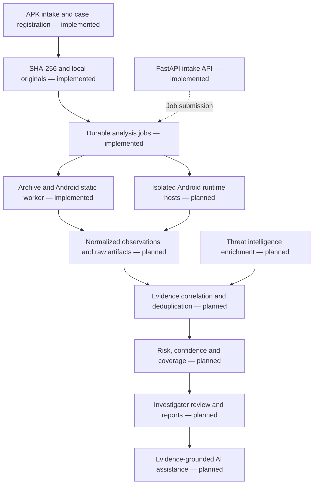

<div align="center">

# 🛡️ GoDeEp

### AI-Assisted Android Application Security & Forensic Analysis Platform


**From suspicious APKs to traceable evidence and explainable findings.**

A platform in development for correlating Android application code, runtime
behaviour, forensic artifacts, and threat intelligence in one investigation workflow.

[Overview](#overview) · [Capabilities](#planned-capabilities) ·
[Architecture](#proposed-architecture) · [Quickstart](#quickstart) ·
[API](#available-api) · [Roadmap](#development-roadmap)

</div>

---

## Overview

Malicious Android applications can conceal functionality through obfuscation,
encrypted payloads, dynamic code loading, and anti-analysis checks. Investigators
must connect findings spread across code inspection, sandbox observations,
network captures, and intelligence sources.

**GoDeEp aims to bring those findings together with their supporting evidence.**
The project targets malware analysts, digital forensic investigators, security
researchers, and law-enforcement workflows under **PS-02 — Malware Analysis**.

The intended outcome is an investigation record that explains what was found,
where it came from, how confidently it can be interpreted, and what the analysis
could not observe.

## Implementation status

> **Milestone 12 — case-scoped APK comparisons:** investigators can compare two
> completed static or threat review runs with evidence references, semantic changes
> and explicit coverage limitations. Forensic JSON report snapshots are available.
> Dynamic analysis, provider connectors, vulnerability matching, scoring, formatted
> reports, AI and production hardening remain planned.

| Area | Current state |
|---|---|
| FastAPI application, configuration and liveness | Implemented |
| Cases and paginated sample metadata | Implemented |
| Bounded raw APK intake and local original-byte storage | Implemented |
| SQLAlchemy models and Alembic migrations | Implemented; SQLite and live PostgreSQL 17.11 tested |
| Transactional case events | Authenticated actors implemented; tamper-evident audit pending |
| Durable job queue and separate worker | Implemented for archive, manifest/certificate and DEX identifier evidence |
| Case-scoped analysis comparison | Implemented for static/threat review observations |
| Forensic JSON report snapshots | Implemented; formatted exports and analyst sign-off pending |
| Malware classification and AI | Planned; no malware verdict yet |
| Authentication and owner/analyst/viewer case access | Implemented; deployment hardening pending |
| Object storage and frontend dashboard | Planned |

## Planned capabilities

| Investigation area | Intended capability | Evidence to preserve |
|---|---|---|
| **Static, manifest & resources** | Inspect permissions, exported components, configurations, resources, and suspicious code | Manifest entries, file paths, class/method references |
| **Dynamic behaviour** | Observe apps in isolated Android environments | Runtime events, file changes, process activity, network captures |
| **Permissions, APIs & evasion** | Investigate sensitive API use, reflection, dynamic loading, obfuscation, and anti-analysis indicators | Rule matches, code locations, instrumentation observations |
| **Network & signing** | Extract destinations and inspect APK signing metadata | URLs, domains, IPs, certificates, signer fingerprints |
| **Library analysis** | Identify embedded libraries and assess vulnerability leads | Component identity, version evidence, advisory references |
| **Threat intelligence** | Enrich indicators with attributable, time-stamped intelligence | Provider, retrieval time, match context, confidence |
| **Risk & correlation** | Connect static indicators with runtime observations | Evidence relationships, scoring factors, analyst review states |
| **Forensic reporting** | Produce structured case reports and compare APKs | Sample hashes, run metadata, artifact references, limitations |
| **AI assistance** | Explain findings and suggest investigation steps | Evidence-linked statements and explicitly labelled hypotheses |

## Evidence and accuracy principles

- **Traceable findings:** preserve original artifacts and link conclusions to supporting evidence.
- **Reproducible runs:** record analyzer versions, rule versions, configuration, and execution environment.
- **Separate risk, confidence, and coverage:** an incomplete run must not become a clean verdict.
- **Avoid duplicate evidence:** several tools reporting the same fact do not establish independent confirmation.
- **Distinguish observation from inference:** an API reference is different from an executed API call; a network connection alone does not prove exfiltration.
- **Validate before claiming accuracy:** use ground-truth apps and labelled evaluation sets; report false positives and category-level precision and recall.
- **Ground AI in evidence:** summaries must cite artifacts, and unsupported explanations remain review hypotheses.

**No detection accuracy, malware-family coverage, or production-readiness benchmark
has been established for GoDeEp yet.**

## Proposed architecture

The diagram describes the target system. Local intake, durable jobs, archive inventory and manifest/certificate extraction
now exist; DEX behaviour and dynamic analysis remain planned.



The intended deployment separates the API, metadata, and evidence storage from
the hosts used to execute untrusted Android applications.

## Technology direction

| Layer | Technology or approach | Status |
|---|---|---|
| Backend API | Python 3.12+, FastAPI, Uvicorn | Included |
| Configuration and contracts | Pydantic / pydantic-settings | Included |
| Verification | pytest, HTTPX, Ruff | Included |
| Metadata | SQLAlchemy + Alembic; PostgreSQL target | Implemented; SQLite and PostgreSQL 17.11 tested |
| Artifact storage | Local original-byte store; object storage later | Local store implemented |
| Background execution | Database queue and bounded subprocess | Implemented; OS isolation pending |
| Analysis engines | Versioned adapters; Androguard 4.1.4 | Manifest/certificate extraction included |
| AI | Evidence-grounded assistance | Planned; model/provider undecided |

## Quickstart

### Prerequisites

- Python **3.12 or newer** and Git.
- Internet access for the initial dependency installation.
- These instructions start the API scaffold. Android SDKs, emulators, and analysis
  engines are not required at this stage.
- For intake endpoints, configure a database and apply migrations using the
  [intake setup guide](docs/intake-development.md) and
  [account setup](docs/authentication.md). The commands below start the API;
  they do not provision PostgreSQL or create tables.

### Windows PowerShell

```powershell
git clone https://github.com/SauravRoy50080/GoDeEp-PS-2.git
cd GoDeEp-PS-2
python -m venv .venv
.\.venv\Scripts\python.exe -m pip install -r requirements-dev.txt
Copy-Item backend/.env.example backend/.env
.\.venv\Scripts\python.exe -m uvicorn godeep.main:app --app-dir backend/src --reload --host 127.0.0.1
```

If the repository is already on your computer, open its root folder and start
at the virtual-environment step. The commands use the environment's Python
directly, so PowerShell activation is unnecessary.

### Linux / macOS

```bash
git clone https://github.com/SauravRoy50080/GoDeEp-PS-2.git
cd GoDeEp-PS-2
python3 -m venv .venv
.venv/bin/python -m pip install -r requirements-dev.txt
cp backend/.env.example backend/.env
.venv/bin/python -m uvicorn godeep.main:app --app-dir backend/src --reload --host 127.0.0.1
```

The API binds to localhost for development. Production deployment configuration
is not included.

### Dependency files

- `requirements.txt`: backend runtime and its dependencies.
- `requirements-dev.txt`: runtime plus pytest, HTTPX and Ruff for development.
- `backend/pyproject.toml`: authoritative package names and supported version ranges.

Run installation commands from the repository root. The requirements files install
this local package and let pip resolve its declared dependencies; they are not
fully pinned lockfiles. Analyzer, sandbox and machine-learning dependencies will
be added as those modules are implemented. PostgreSQL server, Android emulators,
Java and other external tools are not installed by pip.

## Available API

| Method | Path | Purpose |
|---|---|---|
| `GET` | `/api/v1/health/live` | Confirm the API process responds |
| `GET` | `/docs` | Interactive Swagger API documentation |
| `GET` | `/redoc` | Alternative API documentation |
| `GET` | `/openapi.json` | Generated OpenAPI specification |
| `POST` | `/api/v1/auth/login` | Exchange credentials for an expiring bearer token |
| `GET` | `/api/v1/auth/me` | Retrieve authenticated identity |
| `POST` | `/api/v1/auth/logout` | Revoke current session |
| `GET` / `PUT` | `/api/v1/cases/{case_id}/members` | Owner lists or grants membership |
| `DELETE` | `/api/v1/cases/{case_id}/members/{user_id}` | Owner removes membership |
| `POST` / `GET` | `/api/v1/cases` | Create/list investigation cases |
| `GET` | `/api/v1/cases/{case_id}` | Retrieve a case |
| `POST` / `GET` | `/api/v1/cases/{case_id}/samples` | Register raw APK bytes/list samples |
| `GET` | `/api/v1/cases/{case_id}/samples/{sample_id}` | Retrieve sample metadata |
| `GET` | `/api/v1/cases/{case_id}/audit` | List case events |
| `POST` | `/api/v1/cases/{case_id}/comparisons` | Compare two explicitly selected completed runs |
| `POST` / `GET` | `/api/v1/cases/{case_id}/samples/{sample_id}/reports` | Create/list report snapshots |
| `GET` | `/api/v1/cases/{case_id}/samples/{sample_id}/reports/{report_id}` | Read report metadata |
| `GET` | `/api/v1/cases/{case_id}/samples/{sample_id}/reports/{report_id}/download` | Download verified JSON snapshot |
| `GET` | `/api/v1/analyzers` | List implemented adapter capabilities |
| `POST` / `GET` | `/api/v1/cases/{case_id}/analyses` | Queue/list sample analysis jobs |
| `GET` | `/api/v1/cases/{case_id}/analyses/{job_id}` | Read job status/provenance |
| `POST` | `/api/v1/cases/{case_id}/analyses/{job_id}/cancel` | Cancel a job |
| `POST` | `/api/v1/cases/{case_id}/analyses/{job_id}/retry` | Create an explicit retry |
| `GET` | `/api/v1/cases/{case_id}/analyses/{job_id}/result` | Read hash-verified adapter results |

Open **http://127.0.0.1:8000/docs** after starting the server.

```powershell
Invoke-RestMethod http://127.0.0.1:8000/api/v1/health/live
```

Response:

```json
{"status": "ok"}
```

Liveness does not indicate database, worker, or sandbox readiness. Intake requires
migrated database tables. Upload accepts raw bytes with an `X-Filename` header,
not multipart. All case/sample/audit/member endpoints now require a bearer token.
See [authentication](docs/authentication.md) before using the intake examples.

## Repository structure

```text
GoDeEp-PS-2/
├── backend/
│   ├── src/godeep/
│   │   ├── main.py                 # FastAPI application factory
│   │   ├── api/v1/                 # Versioned routes and liveness endpoint
│   │   ├── core/                   # Application configuration
│   │   ├── schemas/                # API request/response contracts
│   │   ├── domain/                 # Planned cases, samples, evidence, findings
│   │   ├── services/               # Planned use-case orchestration
│   │   ├── persistence/            # SQLAlchemy models and session factories
│   │   ├── storage/                # Local evidence store
│   │   ├── analysis/
│   │   │   ├── static/             # Manifest and certificate analysis
│   │   │   ├── dynamic/            # Planned runtime pipeline
│   │   │   └── correlation/        # Planned correlation and scoring
│   │   ├── integrations/
│   │   │   ├── analyzers/          # Versioned adapters
│   │   │   └── intelligence/       # Planned intelligence providers
│   │   ├── workers/                # Durable worker
│   │   ├── reporting/              # Planned forensic exports
│   │   └── ai/                     # Planned grounded assistance
│   ├── tests/test_health.py
│   ├── migrations/                 # Alembic environment and intake migration
│   ├── .env.example
│   └── pyproject.toml
├── docs/
│   ├── architecture.md
│   ├── repository-patterns.md
│   └── roadmap.md
├── infra/                          # Infrastructure planning notes
├── .gitignore
└── README.md
```

## Development roadmap

- [x] Create backend package structure and configuration.
- [x] Add versioned routing, liveness endpoint, and initial verification.
- [x] Document architecture and research patterns.
- [x] Implement local accounts, sessions, case permissions and authenticated case events.
- [ ] Add deployment hardening, MFA/SSO/recovery and durable security-event monitoring.
- [x] Add bounded APK intake, hashing, metadata persistence, and local evidence storage.
- [x] Implement durable jobs, provenance, explicit retries, timeouts and cancellation for archive inventory.
- [x] Integrate bounded manifest, component, permission and certificate extraction.
- [x] Add bounded DEX method-reference rules and network-string candidates.
- [x] Add bounded instruction decoding and sensitive API invoke-site evidence.
- [x] Add optional official APK signature verification with real signed/tampered tests.
- [x] Add bounded resource, embedded-file and declared-library inventory.
- [ ] Add control-flow/call-graph/evasion analysis and benchmark detection quality.
- [ ] Add isolated Android runtime analysis and coverage reporting.
- [x] Group static findings and add permission context with evidence references.
- [x] Add pinned offline indicator-feed matching with expiry and source claims.
- [ ] Add provider connectors, broader correlation and explainable scoring.
- [x] Add persisted forensic JSON snapshots with source provenance and integrity checks.
- [ ] Add formatted reports, analyst review and AI investigation assistance.
- [ ] Build the investigation dashboard on a separate frontend branch.
- [ ] Evaluate detection quality and operational limitations on held-out datasets.

## Verification

From the repository root on Windows:

```powershell
.\.venv\Scripts\python.exe -m pytest backend/tests
.\.venv\Scripts\python.exe -m ruff check backend
```

On Linux/macOS, use `.venv/bin/python` in place of
`.\.venv\Scripts\python.exe`.

The suite checks liveness, case/sample persistence, original-byte/hash integrity,
case scoping, role permissions, session lifecycle, bounds, failure cleanup, and
migration consistency. It
does not evaluate malware detection or sandbox containment. Live PostgreSQL
verification results and repeatable setup are recorded in
[the test guide](docs/postgresql-verification.md).

## Research foundations

The following projects inform the design and are potential integration candidates.
Androguard 4.1.4 is integrated for manifest decoding and certificate extraction.
The other projects remain research candidates.

| Project | Design relevance |
|---|---|
| [MobSF](https://github.com/MobSF/Mobile-Security-Framework-MobSF) | Unified mobile assessment workflow |
| [Sandroid](https://github.com/fkie-cad/Sandroid_core) | Runtime forensics and ground-truth calibration |
| [Dexray Insight](https://github.com/fkie-cad/Sandroid_Dexray-Insight) | Modular static analysis and review leads |
| [Androguard](https://github.com/androguard/androguard) | Programmatic APK/DEX inspection |
| [Quark Engine](https://github.com/ev-flow/quark-engine) | Rule-driven behaviour analysis |
| [APKiD](https://github.com/rednaga/APKiD) | Compiler, packer, and protection fingerprinting |
| [DroidLysis](https://github.com/cryptax/droidlysis) | Triage artifacts and configurable patterns |
| [AndroPyTool](https://github.com/alexMyG/AndroPyTool) | Batch feature-extraction workflows |
| [MISP](https://github.com/MISP/MISP) | Structured threat intelligence and correlation |

See [repository research](docs/repository-patterns.md) for the review scope,
integration order, and compatibility checks.

## Investigation data handling

APKs, extracted payloads, packet captures, secrets, and private case data belong
outside Git. Relevant exclusions are included in `.gitignore`; review files
before staging them. Future sandboxing and sharing controls are design work,
not protections supplied by this scaffold.

## Documentation and contribution

- [Case-scoped APK analysis comparison](docs/sample-comparison.md)
- [Forensic JSON reports and migration](docs/forensic-reports.md)
- [Offline threat-intelligence correlation](docs/offline-threat-intelligence.md)
- [Resource and library metadata inventory](docs/resource-inventory.md)
- [Backend review and fixes](docs/backend-review.md)
- [Official signature verification](docs/signature-verification.md)
- [Unified static review](docs/unified-static-review.md)
- [Instruction call-site evidence](docs/dex-call-analysis.md)
- [DEX identifier and network-candidate analysis](docs/dex-static-analysis.md)
- [Android static analysis](docs/android-static-analysis.md)
- [Analysis worker setup and job API](docs/analysis-jobs.md)
- [Live PostgreSQL verification and test setup](docs/postgresql-verification.md)
- [Authentication and case permissions](docs/authentication.md)
- [Local intake setup and API walkthrough](docs/intake-development.md)
- [Architecture and design constraints](docs/architecture.md)
- [Implementation roadmap](docs/roadmap.md)
- [Repository research and reusable patterns](docs/repository-patterns.md)

Keep changes focused, document implemented behaviour, and run the available
checks before proposing a change. Keep example data synthetic and non-sensitive.

## License

A project license has not been selected yet. Third-party integration candidates
retain their own licenses; dependency and distribution requirements must be
reviewed before adoption.

---

<div align="center">
<b>GoDeEp · Android Security · Digital Forensics · Evidence-Driven Analysis</b>
</div>
